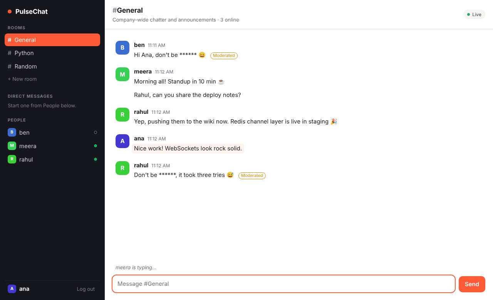

# PulseChat

Real-time chat built with **Django Channels**: public rooms, private DMs, live presence, typing indicators, unread counts and message moderation, all pushed over WebSockets with no page refresh.



## Features

- **Live messaging** over WebSockets, saved to the database and fanned out through a Redis channel layer
- **Rooms and DMs**: create public rooms; start a private 1:1 room from the People list
- **Presence**: see who is online in the current room, updated on every join and leave
- **Typing indicator**, throttled on the client and never echoed back to the typist
- **Unread badges** per room and DM, computed in one SQL query
- **Moderation**: blocked words are masked and the message is tagged "Moderated"; empty and over-long messages are rejected
- **Rate limiting**: 5 messages per 5 seconds per connection (configurable)
- **History paging**: `GET /api/rooms/<slug>/messages/?before=<id>` loads older messages
- **Auto-reconnect** with exponential backoff (1s, 2s, 4s … up to 15s)
- **Security**: session auth on sockets, origin check, DMs closed to outsiders, HTML-safe rendering
- Responsive UI with light and dark themes

## Tech stack

| Layer | Technology |
| --- | --- |
| Backend | Python 3.12, Django 5.1, Django Channels 4 |
| ASGI server | Daphne |
| Real-time broker | Redis (channels-redis) |
| Database | PostgreSQL (Docker) / SQLite (local) |
| Frontend | Django templates, vanilla JS, CSS |
| DevOps | Docker Compose, GitHub Actions, WhiteNoise |

## Architecture

```
Browser ──HTTP──▶ Daphne ──▶ Django views ──▶ PostgreSQL
   │                                         ▲
   └──WebSocket──▶ Daphne ──▶ ChatConsumer ──┘
                                │   ▲
                     group_send │   │ deliver to every socket in "room_<id>"
                                ▼   │
                              Redis channel layer
```

A message goes: browser → `ChatConsumer.receive_json` → moderation + rate limit → saved as a `Message` → `group_send` to the room's group → every consumer in that group (on any server process) → `send_json` → each browser.

## Quick start (local, no Docker)

```bash
python -m venv .venv
source .venv/bin/activate          # Windows: .venv\Scripts\activate
pip install -r requirements.txt
python manage.py migrate           # also creates #general, #python, #random
python manage.py createsuperuser   # optional, for /admin
python manage.py runserver
```

Open http://127.0.0.1:8000, sign up, then open a second browser (or a private window), sign up as another user and chat between them.

Locally the app uses SQLite and an in-memory channel layer, so nothing else needs installing.

## Run with Docker (PostgreSQL + Redis)

```bash
cp .env.example .env
docker compose up --build
```

Open http://localhost:8000.

## Tests

```bash
python manage.py test
```

27 tests cover moderation, rate limiting, views, the history API, and the WebSocket consumer (auth, broadcast, typing, presence, DM privacy, origin check).

## WebSocket protocol

Endpoint: `ws(s)://<host>/ws/chat/<room-slug>/`

| Direction | `type` | Fields |
| --- | --- | --- |
| client → server | `message` | `content` |
| client → server | `typing` | `is_typing` |
| client → server | `read` | — |
| server → client | `message` | `id, room, author, content, flagged, created_at` |
| server → client | `typing` | `user, is_typing` |
| server → client | `presence` | `online` (list of usernames) |
| server → client | `error` | `message` |

Close codes: `4401` not logged in, `4403` no access (someone else's DM), `4404` room not found.

## Project structure

```
pulsechat/
├── config/            settings, URLs, ASGI routing (HTTP + WebSocket)
├── chat/
│   ├── models.py      Room, Membership, Message, Connection
│   ├── consumers.py   ChatConsumer: the WebSocket logic
│   ├── moderation.py  word filter + rate limiter
│   ├── routing.py     WebSocket URL patterns
│   ├── views.py       pages, room/DM creation, history API
│   └── tests/         unit + WebSocket tests
├── accounts/          sign-up view
├── templates/         base, auth pages, chat page
├── static/            app.css, chat.js, ui.js
├── Dockerfile, docker-compose.yml, .github/workflows/ci.yml
```

## Deploying

Any host that runs Docker and supports WebSockets works (Render, Railway, Fly.io, a VPS with Nginx). Set `DJANGO_SECRET_KEY`, `DJANGO_DEBUG=false`, `DJANGO_ALLOWED_HOSTS`, `DJANGO_CSRF_TRUSTED_ORIGINS`, the `POSTGRES_*` variables and `REDIS_URL`, and serve over HTTPS (leave `DJANGO_SECURE_COOKIES` unset so cookies are secure).

## Roadmap

- AI moderation (e.g. a moderation API) behind the existing `moderate()` hook
- Message edit/delete and emoji reactions
- File and image sharing (S3)
- Read receipts and push notifications
- React or Next.js frontend talking to the same WebSocket API
